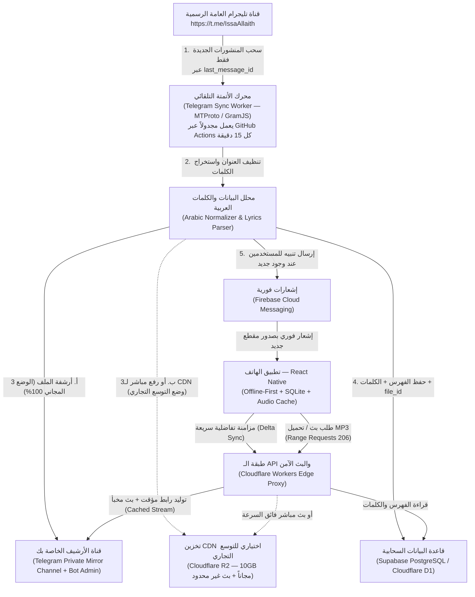

# مكتبة عيسى الليث — Issa Al-Laith Audio & Lyrics App

> **تطبيق هواتف ذكية (React Native) عالي الأداء، خفيف وسريع، بمعمارية حديثة قابلة للاستخدام التجاري — يوفّر مكتبة صوتية متكاملة (MP3) مع الكلمات (Lyrics)، مزوّدة بمحرك أتمتة كامل لسحب وفهرسة المقاطع تلقائياً من القناة العامة الرسمية على تليجرام [`t.me/IssaAllaith`](https://t.me/IssaAllaith) دون الحاجة لشراء سيرفر تقليدي.**

%20%7C%20iOS-3DDC84?style=flat-square&logo=android)


---

## الفهرس

1. [نظرة عامة على المشروع](#1-نظرة-عامة-على-المشروع)
2. [المعمارية التقنية وأتمتة الربط بتليجرام](#2-المعمارية-التقنية-وأتمتة-الربط-بتليجرام)
3. [المزايا الرئيسية وتجربة المستخدم (UI/UX)](#3-المزايا-الرئيسية-وتجربة-المستخدم-uiux)
4. [دعم جميع إصدارات أندرويد وهندسة الأداء](#4-دعم-جميع-إصدارات-أندرويد-وهندسة-الأداء)
5. [المكدس التقني (Tech Stack)](#5-المكدس-التقني-tech-stack)
6. [هيكل المشروع (Project Structure)](#6-هيكل-المشروع-project-structure)
7. [تصميم قاعدة البيانات ونماذج البيانات](#7-تصميم-قاعدة-البيانات-ونماذج-البيانات)
8. [واجهات برمجة التطبيقات (Edge API Specification)](#8-واجهات-برمجة-التطبيقات-edge-api-specification)
9. [محرك الأتمتة ومحلل الكلمات العربية](#9-محرك-الأتمتة-ومحلل-الكلمات-العربية)
10. [دليل الإعداد والربط الكامل مع تليجرام](#10-دليل-الإعداد-والربط-الكامل-مع-تليجرام)
11. [متغيرات البيئة (Environment Variables)](#11-متغيرات-البيئة-environment-variables)
12. [الأمان والموثوقية والجاهزية التجارية](#12-الأمان-والموثوقية-والجاهزية-التجارية)
13. [خطة البناء والتطوير المرحلية (Roadmap)](#13-خطة-البناء-والتطوير-المرحلية-roadmap)
14. [قائمة التحقق قبل الإطلاق التجاري وملاحظة حقوق النشر](#14-قائمة-التحقق-قبل-الإطلاق-التجاري-وملاحظة-حقوق-النشر)

---

## 1. نظرة عامة على المشروع

يهدف هذا المشروع إلى بناء تطبيق صوتيات وكلمات بمستوى تطبيقات البث العالمية (مثل Spotify و Apple Music)، مخصص لأعمال **عيسى الليث**، مع حل جذري لمشكلة الاستضافة وتكلفة السيرفرات عبر بنية **Serverless + Telegram Automation**:

- **أتمتة كاملة من القناة العامة الرسمية:** سحب المقاطع الصوتية (`MP3`) والكلمات المرفقة (`Caption`) والبيانات الوصفية تلقائياً فور نشرها على [`https://t.me/IssaAllaith`](https://t.me/IssaAllaith).
- **تطبيق React Native بأداء أصلي (Native Feel):** مبني بـ **New Architecture (Fabric + TurboModules)** ومحرك **Hermes**، خفيف الحجم (`~14–18 MB`) وسريع الإقلاع (`< 1.2s`).
- **Offline-First بالكامل:** قاعدة بيانات محلية للبحث الفوري في العناوين والكلمات بدون إنترنت، مع تخزين مؤقت ذكي وتحميل صريح للاستماع أوفلاين.
- **تصميم عربي أصيل (RTL-First):** واجهات حديثة وفق معايير **Material Design 3** و **WCAG 2.1 AA** مع وضع ليلي فخم (AMOLED Dark) ووضع نهاري، وألوان ديناميكية، ومشغّل عائم سلس بمعدل **60/120 FPS**.
- **جاهزية تجارية وقابلية توسع:** فصل تام بين مصدر البيانات (تليجرام)، وطبقة التخزين/البث، والتطبيق — مع إمكانية الترقية الفورية إلى **Cloudflare R2** عند وصول التطبيق لعشرات الآلاف من المستخدمين المتزامنين دون تغيير سطر واحد في تطبيق الهاتف.

---

## 2. المعمارية التقنية وأتمتة الربط بتليجرام

### لماذا نحتاج معمارية ذكية للربط بقناة عامة؟

قناة [`t.me/IssaAllaith`](https://t.me/IssaAllaith) هي **قناة عامة لا نملك فيها صلاحية مشرف (Admin)**، وبالتالي:
1. لا يستطيع **Telegram Bot API** وحده قراءة منشوراتها مباشرة.
2. لا يجوز أبداً وضع مفاتيح تليجرام (`API_HASH` أو `BOT_TOKEN` أو `SESSION`) داخل تطبيق الهاتف لأن استخراجها من ملف APK أمر سهل ويؤدي لحظره فوراً.
3. روابط تحميل ملفات تليجرام (`getFile`) **مؤقتة** وتنتهي صلاحيتها خلال ~60 دقيقة.

### الحل المعماري المعتمد (آمن، مجاني، وقابل للتوسع التجاري)



### شرح آلية العمل خطوة بخطوة

1. **الاكتشاف التلقائي (Automated Polling):** يعمل محرك `telegram-sync` تلقائياً كل **15 دقيقة** عبر **GitHub Actions** (مجاني بالكامل)، ويتصل عبر **MTProto (GramJS)** بقناة `IssaAllaith` لجلب الرسائل الأحدث من آخر `last_message_id` محفوظ فقط.
2. **التصفية الذكية:** يتجاهل الرسائل غير الصوتية (الإعلانات، الصور المنفردة، أو الروابط غير المرتبطة)، ويلتقط ملفات الصوت (`audio/mpeg`، `MP3`)، كما يربط ذكياً بين رسالة الصوت ورسالة الكلمات إذا نُشرت الكلمات في رسالة منفصلة تلي المقطع مباشرة.
3. **التخزين المرن (Dual Storage Strategy):**
   - **الوضع الافتراضي (`STORAGE_MODE=telegram` — مجاني 100% بدون بطاقة بنكية):** يقوم المحرك بتوجيه/نسخ الملف الصوتي إلى **قناتك الخاصة المخفية** التي أضفت فيها البوت الخاص بك كـ Admin، فيحصل على `bot_file_id` دائم وثابت، وتخزن البيانات الوصفية والكلمات في قاعدة البيانات.
   - **وضع التوسع التجاري (`STORAGE_MODE=r2` — موصى به عند النمو الكبير):** يرفع المحرك ملف الـ MP3 مباشرة إلى **Cloudflare R2** (مجاني حتى 10GB أي ~1,500–2,000 مقطع، وباندويث غير محدود مجاناً 100%) مع بث فائق السرعة دون أي قيود Rate Limits من تليجرام.
4. **البث الآمن عبر Edge Proxy:** التطبيق لا يتواصل مع تليجرام مباشرة أبداً؛ بل يتواصل مع **Cloudflare Worker** الذي يمرّر البث الصوتي بدعم كامل لـ **HTTP Range Requests (`206 Partial Content`)** للتقديم والترجيع الفوري، مع حماية التوكنات وتخزين مؤقت على حافة الشبكة (Edge Cache).
5. **المزامنة التفاضلية (Delta Sync):** عند فتح التطبيق، يطلب فقط ما تغيّر بعد `last_synced_at` (بضعة كيلوبايت فقط)، فيحدّث قاعدة بيانات الهاتف المحلية فوراً.

---

## 3. المزايا الرئيسية وتجربة المستخدم (UI/UX)

### الهوية البصرية ونظام التصميم (Design System)

| العنصر | المعيار المعتمد |
| :--- | :--- |
| **الاتجاه واللغة** | **RTL-First** أصيل للغة العربية مع دعم كامل لعكس الأيقونات والإيماءات والتخطيط (`I18nManager`). |
| **نظام التصميم** | **Material Design 3 (Material You)** بلمسة بصرية معاصرة مستوحاة من أرقى تطبيقات الصوتيات. |
| **الأوضاع اللونية** | **الوضع الداكن الفخم (AMOLED Pure Dark `#0B0D12`)** كافتراضي + **الوضع النهاري النقي (`#F8F9FB`)** + ألوان مشتقة ديناميكياً (`Dynamic Accent`) لكل مقطع. |
| **الخطوط العربية** | **IBM Plex Sans Arabic** أو **Readex Pro** للواجهات (وضوح فائق على كل الكثافات)، وخط **Amiri / Tajawal** لعرض القصائد والكلمات مع تباعد سطور مريح (`lineHeight: 1.9`). |
| **الحركة والتفاعل** | **60/120 FPS** عبر `Reanimated` على UI Thread، استجابة لمسية خفيفة (**Haptic Feedback**)، وانتقالات سلسة بين المشغّل المصغّر والكامل. |
| **إمكانية الوصول** | التزام كامل بمعيار **WCAG 2.1 AA**: تباين ألوان `≥ 4.5:1`، مساحات لمس `≥ 48×48dp`، دعم **TalkBack**، واحترام إعدادات حجم الخط وتقليل الحركة. |

### الشاشات وتدفق المستخدم (Information Architecture)

1. **الشاشة الرئيسية (Home):**
   - بطاقة بارزة لآخر مقطع نُشر تلقائياً من القناة (`الأحدث الآن`).
   - قسم **استكمل الاستماع (Continue Listening)** مع شريط التقدم المحفوظ.
   - قوائم ذكية: **الأكثر استماعاً**، **أضيف حديثاً**، و**تصفح حسب التصنيف / السنة**.
   - **بطاقة بيت اليوم (Featured Lyrics Quote):** مقتطف شعري قابل للمشاركة الفورية.
2. **المكتبة الشخصية (Library):**
   - جميع المقاطع (قابلة للفرز: الأحدث، الأقدم، الأكثر تشغيلاً، أبجدياً).
   - **التحميلات (أوفلاين):** إدارة الملفات المحفوظة مع عرض المساحة المستهلكة وميزة **التحميل الدفعي**.
   - **المفضلة (Favorites)** و**قوائم التشغيل المخصصة (Custom Playlists)** بإنشاء وترتيب حر.
   - **سجل الاستماع (History)**.
3. **البحث العربي الذكي الفوري (Instant Arabic Search — يعمل أوفلاين!):**
   - بحث فوري (`< 15ms`) داخل قاعدة بيانات SQLite المحلية (FTS5) دون الحاجة للإنترنت.
   - **تطبيع عربي ذكي (Arabic Normalization):** يطابق النتائج بغض النظر عن التشكيل أو الهمزات أو التاء المربوطة (`أ/إ/آ ← ا`، `ة ← ه`، `ى ← ي`، حذف الحركات والتطويل `ـ`).
   - يبحث في **عنوان المقطع + الكلمات والأبيات الداخلية + اسم الشاعر** مع تظليل النص المطابق (Snippet Highlighting).
4. **المشغّل المصغّر العائم (Floating Mini-Player):**
   - ظاهر بانسيابية فوق شريط التبويب السفلي مع غلاف المقطع، زر التشغيل/الإيقاف، شريط تقدم نحيف، وإيماءة السحب يميناً/يساراً للتنقل بين المقاطع، أو السحب للأعلى لفتح المشغّل الكامل.
5. **شاشة المشغّل الكاملة والكلمات الغامرة (Full Player & Immersive Lyrics):**
   - خلفية متدرجة ناعمة مستوحاة من ألوان الغلاف مع تأثير ضبابي زجاجي خفيف.
   - شريط تمرير دقيق (`Seekbar`) مع معاينة الوقت، أزرار التقديم/الترجيع `10 ثوانٍ`، التكرار (مقطع / قائمة)، التشغيل العشوائي، سرعة التشغيل (`0.75x` – `1.5x`)، و**مؤقت النوم (Sleep Timer)**.
   - **وضع الكلمات المدمج (Lyrics Mode):**
     - انتقال سلس لعرض الكلمات كاملة بخط واضح قابل للتكبير والتصغير.
     - إبقاء الشاشة مضاءة اختيارياً أثناء قراءة الكلمات (`Keep Screen Awake`).
     - نسخ الكلمات بضغطة زر.
     - **مولّد بطاقة الأبيات (Shareable Lyrics Card):** تحديد 2–4 أبيات وتوليد صورة فنية أنيقة جاهزة للمشاركة على واتساب وتليجرام وإنستغرام.
   - **التشغيل في الخلفية والنظام:** تحكم كامل من شاشة القفل، مركز الإشعارات، سماعات البلوتوث، أزرار السيارة، وإيقاف ذكي تلقائي عند المكالمات أو تشغيل صوت من تطبيق آخر (`Audio Focus`).
6. **الإعدادات (Settings):**
   - المظهر (داكن / فاتح / حسب النظام) وحجم خط الكلمات.
   - إدارة التخزين: تفعيل التخزين المؤقت التلقائي، الحد الأقصى للكاش (مثلاً 250MB / 500MB / 1GB)، وتنظيف الكاش بضغطة زر.
   - إعدادات الإشعارات (تنبيه عند صدور مقطع جديد في قناة عيسى الليث).
   - حالة المزامنة الأخيرة وزر **تحديث المكتبة يدوياً**.

---

## 4. دعم جميع إصدارات أندرويد وهندسة الأداء

صُمّم التطبيق ليعمل بكفاءة مثالية سواء على الهواتف الرائدة (Android 15/16 بشاشات 120Hz) أو الهواتف الاقتصادية القديمة (Android 7.0 بذاكرة 2GB RAM):

| المعيار الهندسي | الإعداد / التنفيذ | الأثر المباشر |
| :--- | :--- | :--- |
| **نطاق إصدارات أندرويد** | `minSdkVersion = 24` (Android 7.0) إلى `targetSdkVersion = 35` (Android 15+) | تغطية **+98.5%** من أجهزة أندرويد النشطة مع التوافق الكامل مع متطلبات Google Play الحديثة. |
| **دعم معماريات المعالجات** | `armeabi-v7a`, `arm64-v8a`, `x86`, `x86_64` + دعم **16 KB Page Size** | عمل مستقر على كافة الهواتف وتوافق إجباري مع Google Play لأجهزة 2025+. |
| **معمارية React Native** | تفعيل **New Architecture (Fabric + TurboModules)** + **Hermes Bytecode** | تقليل استهلاك الذاكرة بنسبة ~35% وزمن إقلاع بارد أقل من `1.2 ثانية`. |
| **حجم التطبيق الصغير** | `AAB App Bundle` + `R8 / ProGuard` + `ShrinkResources` + صور `WebP` + أيقونات `SVG` | حجم تنزيل للمستخدم بين **12MB و 18MB** فقط. |
| **قوائم فائقة السرعة** | استخدام **`@shopify/flash-list`** مع إعادة تدوير الخلايا (View Recycling) | تمرير سلس ثابت على **60/120 FPS** حتى مع وجود آلاف المقاطع. |
| **التعامل مع أندرويد الحديث** | دعم `Edge-to-Edge`, `Predictive Back`, صلاحية `POST_NOTIFICATIONS` (Android 13+), و `FOREGROUND_SERVICE_MEDIA_PLAYBACK` (Android 14+) | تجربة أصلية متوافقة تماماً مع إرشادات Google بدون أعطال (Crashes) على الإصدارات الحديثة. |
| **إدارة الذاكرة والبطارية** | خدمة تشغيل خلفية خفيفة (`MediaSessionService`) + تجميد الكاش بتقنية LRU | استهلاك بطارية شبه معدوم أثناء الاستماع والشاشة مغلقة. |

---

## 5. المكدس التقني (Tech Stack)

### 1) تطبيق الهاتف (`apps/mobile`)
- **الإطار واللغة:** React Native النقي (بدون Expo — جاهز لبناء Android CLI لاحقاً) + **React Native Web (Vite)** للمعاينة والتطوير الفوري في **Chrome** + TypeScript (Strict Mode)
- **محرك الصوت:** طبقة تجريد صوتية (`AudioEngine`) تستخدم HTML5 Audio + MediaSession API على Chrome، وجاهزة للتبديل الفوري إلى `react-native-track-player` عند بناء الـ APK للأندرويد
- **إدارة الحالة والتخزين:** `Zustand` + تخزين محلي مستمر (LocalStorage/IndexedDB على الويب و `SQLite + FTS5` على الأندرويد)
- **محرك البحث العربي الفوري:** بحث أوفلاين فوري في العناوين والشعراء وكامل الأبيات مع تطبيع عربي ذكي (`@shared/arabic/normalize.ts`)

### التشغيل السريع في محاكي متصفح Chrome (دون Expo)

```powershell
# 1. تثبيت حزم التطبيق (سريع وخفيف)
npm install

# 2. تشغيل التطبيق مباشرة في متصفح Chrome
npm run dev
```

سيفتح التطبيق تلقائياً على `http://localhost:5173` داخل محاكي هاتف تفاعلي في Chrome (مع إمكانية تبديل المقاسات من `Android 7 (360px)` حتى `ملء الشاشة` أو فتح `Chrome DevTools Mobile`).

### 2) محرك أتمتة تليجرام (`services/telegram-sync`)
- **البيئة:** Node.js 22+ (TypeScript) — يعمل مجدولاً عبر **GitHub Actions Cron** (أو Docker / VPS اختياري)
- **مكتبة تليجرام MTProto:** `telegram` (**GramJS**) لقراءة القناة العامة [`t.me/IssaAllaith`](https://t.me/IssaAllaith) بدقة وموثوقية عالية
- **استخراج بيانات MP3:** `music-metadata` (قراءة المدة، معدل البت، الوسوم ID3، وغلاف الألبوم إن وُجد)

### 3) طبقة الـ API والبث الآمن (`services/edge-api`)
- **المنصة:** **Cloudflare Workers** + إطار **Hono** (خفيف وفائق السرعة على +300 مركز بيانات عالمي)
- **قاعدة البيانات السحابية:** **Cloudflare D1** (SQLite سحابي مجاني وسريع جداً مع Workers) أو **Supabase PostgreSQL**
- **تخزين الصوت:**
  - الافتراضي: **Telegram Private Archive Channel + Bot API** (مجاني 100%)
  - التوسع التجاري: **Cloudflare R2** (تغيير متغير بيئة فقط)

---

## 6. هيكل المشروع (Project Structure)

يعتمد المشروع بنية **Monorepo** نظيفة وقابلة للصيانة والتوسع التجاري:

```text
essa-alleth/
├── README.md                          # التوثيق الكامل للمشروع (هذا الملف)
├── package.json                       # إدارة المساحات (pnpm workspaces)
├── .github/
│   └── workflows/
│       ├── telegram-sync.yml          # جدولة أتمتة سحب المقاطع كل 15 دقيقة
│       ├── deploy-edge-api.yml        # نشر تلقائي لطبقة Cloudflare Workers
│       └── android-release.yml        # بناء واختبار نسخة أندرويد (CI/CD)
│
├── packages/
│   └── shared/                        # شيفرات مشتركة بين التطبيق والسيرفر ومحرك الأتمتة
│       ├── src/
│       │   ├── types/                 # Track, Lyrics, SyncPayload, ApiResponse
│       │   ├── arabic/
│       │   │   ├── normalize.ts       # تطبيع النص العربي للبحث الذكي
│       │   │   └── lyricsParser.ts    # استخراج وتنظيف العنوان والكلمات والشاعر من المنشور
│       │   └── validation/            # Zod Schemas للتحقق من البيانات
│       └── package.json
│
├── services/
│   ├── telegram-sync/                 # محرك أتمتة سحب المقاطع من t.me/IssaAllaith
│   │   ├── src/
│   │   │   ├── index.ts               # نقطة التشغيل الرئيسية للمزامنة
│   │   │   ├── mtprotoClient.ts       # اتصال GramJS الآمن + معالجة FloodWait
│   │   │   ├── channelScanner.ts      # قراءة المنشورات الجديدة وربط الصوت بالكلمات
│   │   │   ├── storage/
│   │   │   │   ├── telegramMirror.ts  # التوجيه والأرشفة إلى قناتك الخاصة + Bot file_id
│   │   │   │   └── r2Uploader.ts      # (اختياري) الرفع إلى Cloudflare R2
│   │   │   ├── dbSync.ts              # تحديث قاعدة البيانات السحابية
│   │   │   └── notifier.ts            # إرسال إشعار FCM عند نشر مقطع جديد
│   │   ├── scripts/
│   │   │   └── generateSession.ts     # سكربت لمرة واحدة لتوليد StringSession
│   │   └── .env.example
│   │
│   └── edge-api/                      # Cloudflare Workers (Hono) — البوابة الآمنة والبث
│       ├── src/
│       │   ├── index.ts               # تعريف المسارات والـ Middlewares
│       │   ├── middleware/
│       │   │   ├── rateLimit.ts       # حماية ضد إساءة الاستخدام
│       │   │   ├── appSignature.ts    # التحقق من هوية التطبيق (App Integrity / HMAC)
│       │   │   └── cacheHeaders.ts    # ETag & Edge Cache-Control
│       │   ├── routes/
│       │   │   ├── tracks.ts          # قائمة المقاطع والتفاصيل والكلمات
│       │   │   ├── sync.ts            # المزامنة التفاضلية (Delta Sync)
│       │   │   └── stream.ts          # بث MP3 مع دعم Range Requests (206)
│       │   └── providers/
│       │       ├── telegramStream.ts  # جلب رابط getFile المؤقت وتمرير البث بأمان
│       │       └── r2Stream.ts        # البث المباشر من R2 عند تفعيله
│       ├── wrangler.toml              # إعدادات Cloudflare Workers & D1 & R2
│       └── .env.example
│
├── database/
│   └── migrations/
│       ├── 0001_initial_schema.sql    # جداول tracks, lyrics, categories, sync_state
│       └── 0002_fts_arabic_index.sql  # فهارس البحث السريع
│
└── apps/
    └── mobile/                        # تطبيق React Native (Android & iOS)
        ├── android/                   # إعدادات أندرويد الأصلية (Gradle, ProGuard, MediaService)
        ├── ios/                       # إعدادات iOS (جاهز مستقبلاً)
        ├── assets/                    # الخطوط العربية، الأيقونات، الشعارات (WebP / SVG)
        └── src/
            ├── app/                   # التهيئة، Providers، إعداد RTL، Navigation
            ├── theme/                 # ألوان MD3، الخطوط، المسافات، Dark/Light Tokens
            ├── components/            # مكونات واجهة أصلية قابلة لإعادة الاستخدام
            │   ├── MiniPlayer/        # المشغّل المصغّر العائم
            │   ├── TrackRow/          # عنصر المقطع المحسّن لـ FlashList
            │   ├── LyricsCardShare/   # مولّد بطاقات الأبيات للمشاركة
            │   └── Skeleton/          # شاشات التحميل الأنيقة (Shimmer)
            ├── features/
            │   ├── home/              # الشاشة الرئيسية
            │   ├── library/           # المكتبة، التحميلات، المفضلة، قوائم التشغيل
            │   ├── search/            # البحث العربي الذكي أوفلاين (SQLite FTS5)
            │   ├── player/            # المشغّل الكامل، الكلمات، Queue، Sleep Timer
            │   └── settings/          # الإعدادات وإدارة الكاش والمزامنة
            ├── services/
            │   ├── audio/             # تهيئة TrackPlayer و PlaybackService بالخلفية
            │   ├── database/          # قاعدة بيانات SQLite المحلية + Delta Sync Engine
            │   ├── downloads/         # مدير التحميل الأوفلاين و LRU Cache
            │   └── api/               # عميل HTTP مع Retry و Offline Fallback
            └── store/                 # Zustand Stores (Player, Theme, Settings)
```

---

## 7. تصميم قاعدة البيانات ونماذج البيانات

### أ) قاعدة البيانات السحابية (Cloudflare D1 / SQLite / PostgreSQL)

```sql
-- جدول المقاطع الصوتية المفهرسة تلقائياً من تليجرام
CREATE TABLE tracks (
    id TEXT PRIMARY KEY,                    -- UUID أو tg_<source_msg_id>
    source_channel TEXT NOT NULL,           -- 'IssaAllaith'
    source_message_id INTEGER NOT NULL UNIQUE,
    title TEXT NOT NULL,                    -- اسم المقطع المنظّف
    title_normalized TEXT NOT NULL,         -- اسم مطبّع للبحث العربي
    poet TEXT,                              -- اسم الشاعر (إن وُجد في المنشور)
    category TEXT DEFAULT 'زوامل',          -- التصنيف المستخلص
    duration_sec INTEGER NOT NULL DEFAULT 0,-- مدة المقطع بالثواني
    file_size_bytes INTEGER NOT NULL DEFAULT 0,
    mime_type TEXT DEFAULT 'audio/mpeg',
    storage_provider TEXT NOT NULL,         -- 'telegram' | 'r2'
    telegram_file_id TEXT,                  -- file_id من البوت في قناة الأرشيف
    telegram_archive_msg_id INTEGER,        -- رقم الرسالة في قناة الأرشيف
    r2_object_key TEXT,                     -- مسار الملف في R2 (عند التفعيل)
    cover_url TEXT,                         -- صورة الغلاف (اختياري)
    published_at TEXT NOT NULL,             -- تاريخ النشر الأصلي في القناة (ISO-8601)
    updated_at TEXT NOT NULL,               -- آخر تعديل (يُستخدم في Delta Sync)
    is_deleted INTEGER NOT NULL DEFAULT 0   -- Soft Delete للمزامنة الدقيقة
);

-- جدول الكلمات (منفصل لتسريع جلب القوائم وخفض استهلاك البيانات)
CREATE TABLE track_lyrics (
    track_id TEXT PRIMARY KEY REFERENCES tracks(id) ON DELETE CASCADE,
    lyrics_raw TEXT NOT NULL,               -- النص الأصلي المنسق للأبيات
    lyrics_normalized TEXT NOT NULL,        -- نص مطبّع للبحث الفوري داخل الكلمات
    lyrics_message_id INTEGER,              -- رقم رسالة الكلمات إن كانت منفصلة عن الصوت
    updated_at TEXT NOT NULL
);

-- جدول تتبع حالة الأتمتة لمنع التكرار واستئناف السحب بدقة
CREATE TABLE sync_state (
    channel_username TEXT PRIMARY KEY,      -- 'IssaAllaith'
    last_message_id INTEGER NOT NULL DEFAULT 0,
    last_run_at TEXT NOT NULL,
    total_synced INTEGER NOT NULL DEFAULT 0,
    last_status TEXT NOT NULL DEFAULT 'ok'
);

CREATE INDEX idx_tracks_published ON tracks(published_at DESC);
CREATE INDEX idx_tracks_updated ON tracks(updated_at ASC);
CREATE INDEX idx_tracks_category ON tracks(category);
```

### ب) قاعدة البيانات المحلية على الهاتف (Offline-First SQLite + FTS5)

تحتفظ بنسخة مضغوطة من `tracks` و `track_lyrics` مع جدول بحث نصي فائق السرعة (`FTS5`) وجداول المستخدم المحلية:
- `tracks_fts` — فهرس `FTS5` على `title_normalized`, `poet`, `lyrics_normalized` للبحث في أقل من `15ms` بدون إنترنت.
- `local_downloads` — مسار الملف الصوتي المحلي، حالة التحميل (`queued | downloading | completed | failed`)، التقدم، وحجم الملف.
- `favorites` — المقاطع المفضلة وتاريخ إضافتها.
- `playlists` & `playlist_items` — قوائم التشغيل المخصصة بترتيب قابل للتعديل.
- `play_history` — آخر موضع توقف (`last_position_sec`) وعدد مرات التشغيل لكل مقطع.

---

## 8. واجهات برمجة التطبيقات (Edge API Specification)

جميع الطلبات تمر عبر **Cloudflare Workers** عبر HTTPS ومحمية بـ Rate Limiting و Header تحقق من التطبيق:

| المسار (Endpoint) | الطريقة | الوصف | استراتيجية الكاش |
| :--- | :--- | :--- | :--- |
| `/v1/health` | `GET` | فحص صحة الخدمة وحالة آخر مزامنة مع تليجرام | No Cache |
| `/v1/sync?since={ISO_DATE}&cursor={ID}` | `GET` | **المزامنة التفاضلية:** يعيد فقط المقاطع والكلمات الجديدة أو المعدّلة أو المحذوفة منذ آخر فتح للتطبيق | `ETag` + Edge Cache 60s |
| `/v1/tracks?page=1&limit=30&category=...` | `GET` | استعراض المقاطع بترقيم صفحات (Pagination) | Edge Cache 120s |
| `/v1/tracks/:id` | `GET` | تفاصيل مقطع محدد مع كلماته الكاملة | Edge Cache 10m |
| `/v1/tracks/:id/stream` | `GET` | **بث/تحميل ملف MP3** مع دعم كامل لـ `Range: bytes=start-end` (`206 Partial Content`) | Edge Cache + Smart Revalidate |
| `/v1/stats/popular` | `GET` | قائمة المقاطع الأكثر استماعاً (مجهولة الهوية) | Edge Cache 1h |

### نموذج استجابة المزامنة التفاضلية (`/v1/sync`)

```json
{
  "serverTime": "2026-11-24T03:30:00Z",
  "hasMore": false,
  "nextCursor": null,
  "tracks": [
    {
      "id": "tg_4821",
      "sourceMessageId": 4821,
      "title": "عنوان الزامل",
      "poet": "اسم الشاعر",
      "category": "زوامل",
      "durationSec": 248,
      "fileSizeBytes": 5941200,
      "publishedAt": "2026-11-23T18:10:00Z",
      "updatedAt": "2026-11-23T18:15:02Z",
      "hasLyrics": true,
      "lyrics": "الأبيات الكاملة منسّقة سطراً بسطر...",
      "isDeleted": false
    }
  ]
}
```

---

## 9. محرك الأتمتة ومحلل الكلمات العربية

### كيف يعمل محرك `telegram-sync` بكفاءة وأمان؟

1. **الأرشفة الأولية (Initial Backfill — تُشغّل مرة واحدة):**
   - يسحب أرشيف القناة التاريخي على دفعات هادئة (مثلاً 50 رسالة كل دفعة مع مهلة `1.5–3 ثوانٍ` بين الدفعات) لتجنب `FloodWaitError` من تليجرام تماماً.
   - يحفظ التقدم بعد كل دفعة في `sync_state` بحيث لو توقف السكربت يستكمل من آخر نقطة تلقائياً.
2. **المزامنة الدورية التلقائية (Incremental Sync — كل 15 دقيقة):**
   - يجلب فقط الرسائل ذات `id > last_message_id` من `t.me/IssaAllaith`.
   - في أغلب الأوقات لن يكون هناك جديد فيغلق الاتصال في أقل من ثانيتين باستهلاك شبه صفري!
3. **الربط الذكي بين الـ MP3 والكلمات (Smart Pairing):**
   - **الحالة 1:** الكلمات مكتوبة في الـ `Caption` الخاص بملف الـ MP3 نفسه ← يستخرجها مباشرة.
   - **الحالة 2:** نُشرت الكلمات في رسالة نصية منفصلة مباشرة قبل أو بعد ملف الـ MP3 (ضمن نافذة زمنية ≤ 10 دقائق) ← يربطها المحرك تلقائياً بنفس المقطع.
   - **الحالة 3:** المقطع بدون كلمات حالياً ← يُفهرس الصوت فوراً مع `hasLyrics: false` ويظل قابلاً للتحديث إذا تم تعديل الرسالة لاحقاً.
4. **محلل وتنظيف النصوص العربية (`arabic/lyricsParser.ts`):**
   - يزيل الروابط الترويجية المتكررة ومعرّفات القنوات (`@IssaAllaith`، روابط الاشتراك) من نهاية الكلمات مع الإبقاء على نص القصيدة نقياً.
   - يستخرج تلقائياً: **العنوان** (من وسم `ID3 Title` أو أول سطر في المنشور)، **الشاعر** (عبر أنماط مثل `كلمات الشاعر:` / `كلمات:`)، و**التصنيف** من الوسوم والهاشتاقات.
   - ينتج نسخة مطبّعة (`normalized`) منزوعة التشكيل وموحدة الألف والهاء والياء لتغذية محرك البحث الفوري.

---

## 10. دليل الإعداد والربط الكامل مع تليجرام

اتبع هذه الخطوات لتهيئة الربط الكامل بشكل آمن وجاهز للإنتاج (لا يتطلب أي سيرفر مدفوع):

### الخطوة 1: الحصول على مفاتيح Telegram Client API (لقراءة القناة العامة)
1. افتح [my.telegram.org](https://my.telegram.org) وسجّل الدخول برقم هاتف حساب تليجرام **مخصص للأرشفة** (يُفضّل عدم استخدام حسابك الشخصي اليومي).
2. اختر **API development tools** وأنشئ تطبيقاً جديداً للحصول على:
   - `TELEGRAM_API_ID`
   - `TELEGRAM_API_HASH`
3. شغّل سكربت التوليد لمرة واحدة محلياً لتوليد `TELEGRAM_STRING_SESSION` المشفّر، واحفظه في أسرار **GitHub Secrets** (لا يُرفع أبداً للـ Git).

### الخطوة 2: إنشاء قناة الأرشيف الخاصة والبوت (للتخزين المجاني 100%)
1. أنشئ **قناة تليجرام خاصة (Private Channel)** باسم مثلاً `IssaAllaith Archive`.
2. تحدث مع [`@BotFather`](https://t.me/BotFather) وأنشئ بوتاً جديداً عبر `/newbot` للحصول على `TELEGRAM_BOT_TOKEN`.
3. أضف البوت كـ **مشرف (Admin)** في قناتك الخاصة مع صلاحية نشر وقراءة الرسائل.
4. استخرج معرّف قناتك الخاصة `TELEGRAM_ARCHIVE_CHANNEL_ID` (يبدأ عادةً بـ `-100xxxxxxxxxx`).

> **ملاحظة:** البوت يعمل فقط على **قناتك الخاصة** للحصول على `file_id` وبث الملفات عبر Cloudflare Worker، بينما يقوم `MTProto Session` بقراءة القناة العامة الرسمية `t.me/IssaAllaith` وتوجيه المقاطع الجديدة تلقائياً إلى قناتك الخاصة.

### الخطوة 3: إعداد Cloudflare Workers & D1 (مجاني)
1. أنشئ حساباً مجانياً على [Cloudflare](https://dash.cloudflare.com).
2. أنشئ قاعدة بيانات **D1** باسم `essa-alleth-db` وطبّق ملفات الترحيل في `database/migrations/`.
3. أضف المتغيرات السرية (`wrangler secret put`) في Cloudflare Worker:
   - `TELEGRAM_BOT_TOKEN`
   - `API_APP_SECRET`
4. *(اختياري عند التوسع التجاري)*: فعّل **Cloudflare R2** وأنشئ Bucket باسم `essa-alleth-audio` وغيّر `STORAGE_MODE=r2`.

### الخطوة 4: تفعيل الأتمتة التلقائية على GitHub Actions
أضف المتغيرات السرية في إعدادات مستودع GitHub (`Settings → Secrets and variables → Actions`)، وسيعمل ملف `.github/workflows/telegram-sync.yml` تلقائياً كل 15 دقيقة لسحب كل جديد من [`https://t.me/IssaAllaith`](https://t.me/IssaAllaith) وإرسال إشعار فوري للمستخدمين!

### الخطوة 5: إعداد Firebase للإشعارات (اختياري ومجاني)
1. أنشئ مشروعاً في [Firebase Console](https://console.firebase.google.com).
2. حمّل ملف `google-services.json` وضعه في `apps/mobile/android/app/`.
3. فعّل **FCM Topic** باسم `new_tracks` ليشترك فيه المستخدمون تلقائياً عند تفعيل الإشعارات.

---

## 11. متغيرات البيئة (Environment Variables)

### 1) محرك الأتمتة (`services/telegram-sync/.env.example`)
```env
# إعدادات مصدر تليجرام (القناة العامة الرسمية)
SOURCE_CHANNEL_USERNAME=IssaAllaith
TELEGRAM_API_ID=12345678
TELEGRAM_API_HASH=your_telegram_api_hash
TELEGRAM_STRING_SESSION=your_generated_string_session

# إعدادات قناة الأرشيف الخاصة والبوت
TELEGRAM_BOT_TOKEN=123456:ABC-DEF_your_bot_token
TELEGRAM_ARCHIVE_CHANNEL_ID=-1001234567890

# وضع التخزين: telegram (مجاني 100%) أو r2 (للتوسع التجاري)
STORAGE_MODE=telegram

# إعدادات Cloudflare D1 / R2
CLOUDFLARE_ACCOUNT_ID=your_account_id
CLOUDFLARE_API_TOKEN=your_api_token
CLOUDFLARE_D1_DATABASE_ID=your_d1_database_id
R2_BUCKET_NAME=essa-alleth-audio
R2_ACCESS_KEY_ID=optional_r2_key
R2_SECRET_ACCESS_KEY=optional_r2_secret

# الإشعارات الفورية (FCM)
FIREBASE_SERVICE_ACCOUNT_JSON=optional_base64_json
```

### 2) طبقة الـ API والبث (`services/edge-api/.env.example`)
```env
STORAGE_MODE=telegram
TELEGRAM_BOT_TOKEN=123456:ABC-DEF_your_bot_token
API_APP_SECRET=strong_random_hmac_secret_32bytes
MAX_RATE_LIMIT_PER_MIN=120
STREAM_CACHE_TTL_SECONDS=3600
```

### 3) تطبيق الهاتف (`apps/mobile/.env.example`)
```env
# لا توضع أي مفاتيح تليجرام هنا إطلاقاً!
EXPO_PUBLIC_API_BASE_URL=https://api.your-domain.workers.dev
EXPO_PUBLIC_APP_KEY=public_app_client_identifier
EXPO_PUBLIC_SENTRY_DSN=optional_sentry_dsn
```

---

## 12. الأمان والموثوقية والجاهزية التجارية

| المحور | الإجراءات المطبّقة |
| :--- | :--- |
| **حماية الأسرار (Zero Secrets in APK)** | لا يحتوي تطبيق الهاتف على `BOT_TOKEN` ولا `API_HASH` ولا `SESSION` ولا مفاتيح قاعدة البيانات؛ كل ذلك محصور في Cloudflare Secrets و GitHub Secrets. |
| **منع سرقة البث (Anti-Hotlinking)** | توقيع روابط البث المؤقتة بـ **HMAC-SHA256** مع صلاحية زمنية محددة، ومراقبة التردد عبر **Rate Limiting** على Cloudflare Edge. |
| **حدود تليجرام (Telegram Limits Resilience)** | - الحد الأقصى للملف في Bot API هو **20MB** (كافٍ لأغلب ملفات MP3 التي تتراوح بين 3–12MB؛ وللملفات الأكبر يُفعل R2 تلقائياً أو الضغط الملائم).<br>- معالجة تلقائية لـ `FloodWaitError` بانتظار ذكي (`Exponential Backoff`).<br>- تخزين مؤقت داخل التطبيق + Edge Caching لتقليل استدعاءات تليجرام بنسبة تتجاوز **90%**. |
| **المرونة عند انقطاع الإنترنت** | التطبيق يعمل بشكل كامل بدون إنترنت لعرض المكتبة المفهرسة، البحث الفوري في الكلمات، وتشغيل جميع المقاطع المحمّلة أو المخبّأة محلياً مع رسائل حالة واضحة وأنيقة. |
| **مراقبة الجودة والأعطال** | تكامل جاهز مع **Sentry** لرصد أي Crash على مختلف أجهزة أندرويد، وفحوصات TypeScript + ESLint + Jest في خط الـ CI. |

---

## 13. خطة البناء والتطوير المرحلية (Roadmap)

- [ ] **المرحلة 1 — تأسيس الـ Monorepo والحزمة المشتركة (`packages/shared`)**
  - تهيئة بيئة العمل بـ TypeScript، أنواع البيانات المشتركة، ومحرك التطبيع العربي ومحلل الكلمات (`arabic/normalize.ts` & `lyricsParser.ts`) مع اختبارات شاملة.
- [ ] **المرحلة 2 — قاعدة البيانات ومحرك أتمتة تليجرام (`database` + `services/telegram-sync`)**
  - إنشاء جداول D1، بناء عميل GramJS الآمن، سحب وفهرسة قناة `t.me/IssaAllaith`، الأرشفة التلقائية، وإعداد GitHub Actions Cron كل 15 دقيقة.
- [ ] **المرحلة 3 — طبقة الـ Edge API والبث الصوتي (`services/edge-api`)**
  - بناء نقاط النهاية بـ Hono على Cloudflare Workers، دعم `Delta Sync`، ودعم بث الـ MP3 بـ `Range Requests 206` مع الحماية والكاش.
- [ ] **المرحلة 4 — تأسيس تطبيق React Native ونظام التصميم (`apps/mobile`)**
  - إعداد React Native بالـ New Architecture + Hermes + دعم Android API 24–35 + RTL-First + نظام ألوان Material Design 3 والخطوط العربية.
- [ ] **المرحلة 5 — محرك الصوت والمزامنة المحلية (Audio Engine & Offline-First)**
  - دمج `react-native-track-player` (تشغيل خلفي + شاشة القفل + البلوتوث)، إعداد SQLite + FTS5 للبحث العربي أوفلاين، ومدير التحميلات والـ LRU Cache.
- [ ] **المرحلة 6 — الشاشات وتجربة المستخدم الفائقة**
  - بناء الرئيسية، المكتبة، البحث الفوري، المشغّل المصغّر العائم، المشغّل الكامل، وضع الكلمات الغامر، ومولّد بطاقات مشاركة الأبيات.
- [ ] **المرحلة 7 — الاختبار المكثف، تحسين الأداء، وتجهيز الإطلاق التجاري**
  - اختبار على أجهزة أندرويد حقيقية (إصدارات قديمة وجديدة)، تقليص حجم الـ AAB، إعداد التوقيع الرقمي (Release Keystore)، وتفعيل الإشعارات والتتبع.

---

## 14. قائمة التحقق قبل الإطلاق التجاري وملاحظة حقوق النشر

### قائمة التحقق التقنية لمتجر Google Play
- [ ] إنشاء مفتاح توقيع إنتاجي آمن (`upload-keystore.jks`) وتفعيل **Play App Signing**.
- [ ] بناء التطبيق بصيغة **Android App Bundle (`.aab`)** مع تفعيل **R8 Minification** والتحقق من توافق **16 KB Page Size**.
- [ ] اختبار التشغيل في الخلفية والإشعارات على **Android 7/8/10/13/14/15**.
- [ ] إعداد صفحة **سياسة الخصوصية (Privacy Policy)** وتعبئة نموذج **Data Safety** بوضوح.
- [ ] التحقق من خلو النسخة النهائية من أي `console.log` أو مفاتيح تطويرية.

### تنبيه قانوني وتجاري مهم
> قبل نشر التطبيق تجارياً على **Google Play Store** أو **Apple App Store** أو تفعيل الإعلانات/الاشتراكات عليه، يُنصح بالتأكد من الحصول على **إذن أو تفويض رسمي لاستخدام وتوزيع المحتوى الصوتي والكلمات** من أصحاب الحقوق أو إدارة القناة الرسمية، وتضمين صفحة تواصل / طلب إزالة محتوى (DMCA / Contact) داخل التطبيق لتجنب رفض المتجر أو إزالة التطبيق لاحقاً.

---

**جاهز للبدء في التنفيذ الفعلي!** يمكننا الآن الانتقال مباشرة إلى **المرحلة 1** وبناء هيكل المشروع والشيفرات خطوة بخطوة.

